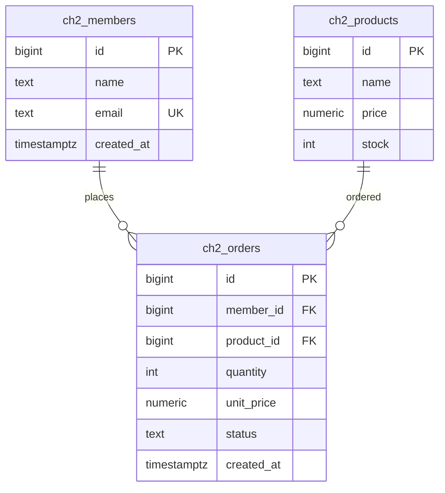

# CH2 · 회원·상품·주문 CRUD

작성자: 유상진

## 01 목적과 범위
회원이 상품을 주문하면 세 종류의 정보가 생긴다. 회원 정보를 주문마다 복사하면 연락처 하나를 바꿀 때 여러 주문을 고쳐야 한다. 회원·상품·주문을 분리하고 ID로 연결하여 이 중복을 줄인다.

이 과제는 Supabase의 PostgreSQL 데이터베이스에서 회원·상품·주문의 생성(Create), 조회(Read), 수정(Update), 삭제(Delete)를 Python SDK와 SQL로 연습한다. 기존 `buyandsell`의 주문·상품 `table → insert/select/update/delete → execute` 흐름을 세 테이블에 적용했다. 상품 재고 자동 차감, 결제, 회원가입 UI, 웹 화면은 범위에 포함하지 않는다. SDK 실습에서는 승인된 가상 계정으로 로그인한다.

**검증 상태:** Python 단위테스트 8개 통과. 전용 Supabase에서 스키마 생성 및 SQL 실증 검증 8개 항목 모두 통과했다. Python SDK의 실제 서버 연결 실행과 증빙 이미지 첨부는 아직 완료하지 않았다.

## 02 테이블과 관계
기존 테이블과 충돌하지 않도록 `ch2_` 접두사를 사용한다. 반드시 별도의 비어 있는 실습 프로젝트에서 실행한다.

|테이블|주요 필드|규칙|
|---|---|---|
|ch2_members|id, name, email, created_at|id 기본키, email 중복 금지, 이름 필수|
|ch2_products|id, name, price, stock|id 기본키, 가격·재고 0 이상|
|ch2_orders|id, member_id, product_id, quantity, unit_price, status, created_at|두 외래키, 수량 1 이상, 주문가격 0 이상|



- 기본키(PK, Primary Key, 프라이머리 키): 한 행을 구분하는 번호다.
- 외래키(FK, Foreign Key, 포린 키): 다른 테이블의 번호를 참조한다. 없는 회원이나 상품을 주문에 넣을 수 없다.
- 주문 1행은 상품 1종을 의미한다. 여러 상품 장바구니는 이 실습에서 다루지 않는다.
- `unit_price`는 주문 당시 가격이다. 이후 상품 가격이 바뀌어도 주문가격은 유지한다.
- 회원·상품에 주문이 남아 있으면 삭제를 차단한다. 주문부터 삭제해야 한다.

> 2026-11-16 보완: 소유자 정책 3개 조회를 확인했다. 실제 Python SDK 실행과 증빙 캡처는 여전히 미완료다. Windows에서 실행 정책 오류 4551이 발생하면 보안 설정을 끄거나 다른 실행 파일로 우회하지 않고 관리자가 허용한 환경을 확인한다.

## 03 실행 순서
1. Python 3.11 이상과 uv를 준비한다.
2. 비어 있는 Supabase 실습 프로젝트에서 `sql/01_schema.sql`을 실행한다. 같은 이름의 테이블이 있으면 중단한다.
3. 프로젝트 폴더에서 `uv sync`를 실행한다.
4. `.env.example`을 `.env`로 복사하고 실습 프로젝트의 URL·공개용 키·승인된 실습 계정 이메일을 **로컬에서만** 입력한다.
5. `uv run python demo.py`는 설명만 출력하며 DB를 변경하지 않는다.
6. 실제 쓰기 실습을 할 때만 `uv run python demo.py --run-demo`를 실행한다.
7. SQL 02/03 실습은 소유자 RLS 적용 전에만 실행한다. 이미 owner_id 정책을 적용한 프로젝트에서는 재실행하지 않는다. 암호는 SDK 실행 중 숨김 입력한다.

SDK 데모는 실행마다 고유한 가상 회원·상품을 생성한다. 생성한 ID만 대상으로 조회·수정하며, 주문 → 상품 → 회원 순서로 삭제한다. 중간 실패 시 앞서 생성한 실습 데이터가 남을 수 있다. 로그의 ID를 확인하고 해당 실습 데이터만 정리한다. SDK 개별 호출은 하나의 다중 작업 트랜잭션이 아니다.

## 04 파일 역할
|파일|역할|
|---|---|
|crud.py|세 테이블의 공통 CRUD. 수정·삭제는 반드시 ID 필터 사용|
|demo.py|가상 회원·상품·주문 생성 후 실제 조회로 변경 결과 확인|
|sql/01_schema.sql|테이블·제약조건·인덱스·RLS 생성|
|sql/02_crud.sql|SQL 방식 3테이블 CRUD 및 ROLLBACK 실습|
|sql/03_verify.sql|CRUD·JOIN·제약조건 8개 항목 자동 검증|
|tests/test_crud.py|네트워크 없이 SDK 호출 형태와 안전장치 확인|

## 05 트랜잭션과 접근 제어
- `BEGIN`: 변경 묶음을 시작한다.
- `COMMIT`: 변경 묶음을 확정한다. 스키마 생성 파일에서 사용한다.
- `ROLLBACK`: 아직 확정하지 않은 변경을 취소한다. SQL CRUD 예제에서 사용한다. ID 시퀀스 값까지 복원되는 것은 아니다.
- RLS(Row Level Security, 로 레벨 시큐리티): 어느 행을 읽고 바꿀 수 있는지 제한한다. 01 스키마는 RLS만 켜며, 별도 소유자 정책은 승인된 실습 계정이 자기 행만 접근하도록 제한한다.
- 현재 SDK 코드는 공개용 키와 승인된 실습 계정 로그인을 사용한다. 관리자 키를 사용하지 않는다. **암호·토큰·키를 캡처, README, GitHub에 넣지 않는다.** 정책 존재 확인과 실제 SDK 권한 검증은 구분한다.

## 06 실행 검증과 제출 증빙
```bash
python -m unittest discover -s tests -v
```
단위테스트는 실제 Supabase 서버·제약조건·권한을 검증하지 않는다. 다음 실증 자료를 추가한 후 제출한다.

- [ ] Supabase에서 세 테이블 및 PK/FK 관계 확인 화면
- [ ] Python SDK 회원·상품·주문 각각 생성·조회·수정·삭제 실제 결과
- [x] SQL 회원·상품·주문 CRUD 및 ROLLBACK 실행 확인
- [x] 잘못된 외래키, 0인 수량, 중복 이메일 입력이 거절되는 실제 결과
- [ ] `.env`, 키, 개인 정보가 없는지 화면·Git 변경분 확인
- [ ] `docs/screenshots/`에 실제 캡처 저장하고 이 README에 상대경로로 연결
- [ ] 본인 공개 GitHub 링크와 LMS 과제 항목을 대조 후 제출

SQL 실제 검증 결과: CREATE, READ JOIN, UPDATE, UNIQUE, CHECK, FK, RESTRICT, DELETE 모두 PASS. Supabase SQL Editor 결과 화면에서 확인했다. 저장된 캡처 파일은 아직 없다. 설계도·목업은 실제 실행 증빙이 아니다.

## 07 스스로 설명할 질문
1. 왜 주문 테이블에 회원 이름 대신 회원 ID를 넣었는가?
2. 상품 가격과 주문 당시 가격을 왜 따로 저장하는가?
3. update/delete에 ID 필터가 없으면 무엇이 위험한가?
4. 주문을 먼저 지우는 이유는 무엇인가?
5. SDK 3번 호출과 SQL 하나의 트랜잭션은 어떻게 다른가?

## 참고
- 수업 실습 원본: buyandsell의 orders.ipynb, products.ipynb
- [Supabase Python 업데이트](https://supabase.com/docs/reference/python/update)
- [Supabase Python 삭제](https://supabase.com/docs/reference/python/delete)
- [Supabase RLS](https://supabase.com/docs/guides/database/postgres/row-level-security)
